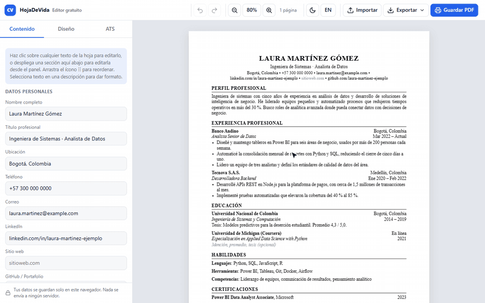
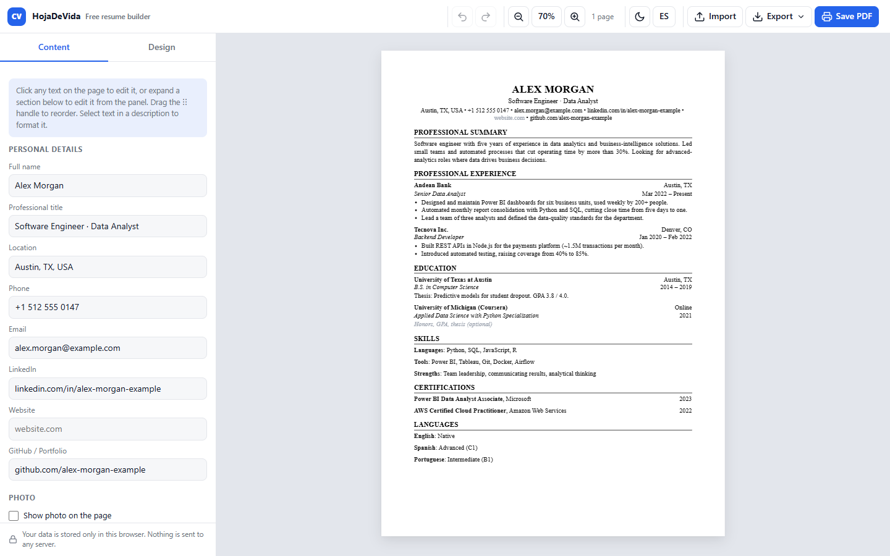
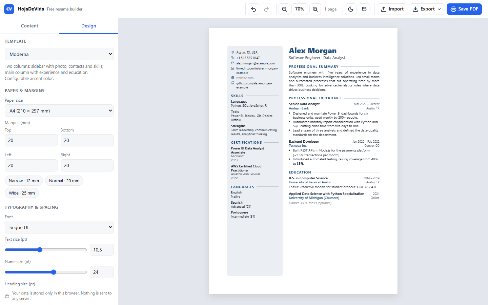
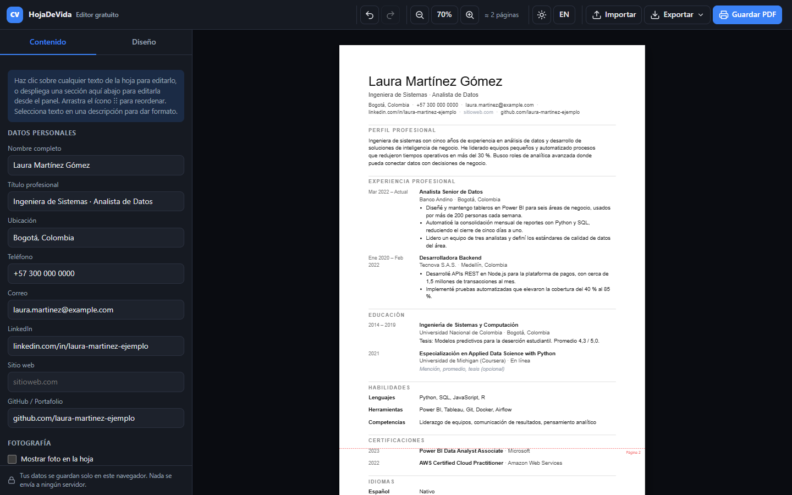
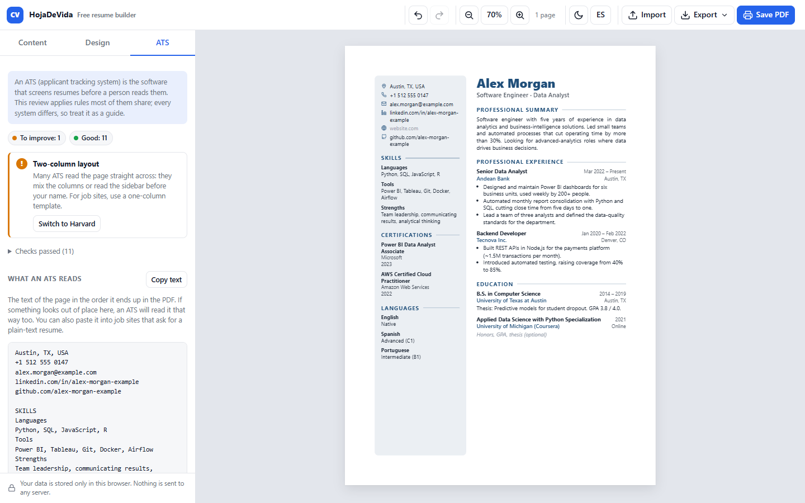

# HojaDeVida: editor gratuito de hojas de vida

[English](README.md) · **Español**

[](https://github.com/JulianContreras02/cv-builder/actions/workflows/ci.yml)


[](LICENSE)

**Demo en vivo: <https://juliancontreras02.github.io/cv-builder/>**

[](https://juliancontreras02.github.io/cv-builder/)

Editor de hojas de vida (CV) que corre completamente en el navegador. Escribes directamente sobre
la hoja, eliges una plantilla y guardas el PDF. No hay cuenta, servidor, muro de pago ni tarjeta de
crédito: los datos se quedan en tu navegador y el PDF sale del diálogo de impresión, así que el
texto es vectorial, seleccionable y sin marcas de agua.

Lo hice porque todas las páginas de hojas de vida que probé pedían tarjeta de crédito antes de
dejarme descargar mi propio documento.



| Plantilla Moderna, panel de diseño | Plantilla Minimalista, modo oscuro, interfaz en español |
| --- | --- |
|  |  |

## Qué hace

- **Edición directa sobre la hoja**: cada texto es editable con un clic (nombre, contactos,
  títulos de sección, cargos, fechas, descripciones…). Enter pasa al siguiente campo.
- **Edición desde el panel**: cada sección de la lista se despliega y muestra sus entradas con
  todos sus campos. Lo que escribes en el panel se refleja en la hoja y viceversa.
- **Selector de fechas**: en cualquier campo de fechas eliges precisión por año, mes o día, rango
  o fecha única, "Actual" para lo que sigue en curso, y el formato de salida (Mar 2022,
  Marzo 2022, 03/2022…). El texto resultante sigue siendo editable a mano.
- **Formato dentro de las descripciones**: al seleccionar texto aparece una barra flotante con
  negrita, cursiva, subrayado, listas y enlaces. Escribir `- ` al inicio crea viñetas.
- **Arrastrar y soltar**: reordena secciones y entradas arrastrando el ícono ⋮⋮ (en la hoja o en
  el panel). Arrastra un tipo de sección desde "Agregar sección" al lugar exacto donde la
  quieres. Funciona también en pantallas táctiles (SortableJS).
- **14 tipos de sección**: perfil, experiencia, educación, habilidades, idiomas, proyectos,
  certificaciones, premios, voluntariado, publicaciones, referencias, intereses, personalizada y
  texto libre. Se pueden agregar varias veces, renombrar, ocultar sin borrar y duplicar entradas.
- **Tres plantillas**: Harvard (clásica, una columna), Moderna (dos columnas con color de acento)
  y Minimalista (fechas en una columna izquierda, líneas finas). Cada plantilla declara sus propias
  opciones y el panel las dibuja automáticamente.
- **Revisión ATS**: una pestaña del panel revisa lo que buscan los sistemas que filtran hojas de
  vida, explica cada resultado, ofrece arreglos de un clic y muestra el texto en el orden en que
  lo lee un analizador (ver [Revisión ATS](#revisión-ats)).
- **Diseño**: fuente (del sistema o Google Fonts), tamaño en puntos del texto, del nombre y de los
  títulos, interlineado, espacios, colores, papel (A4, Carta, Legal, Oficio) y márgenes en mm.
- **Foto opcional**: forma (círculo, redondeada, cuadrada), tamaño y posición. Se guarda
  redimensionada dentro de los datos.
- **Guardar PDF** con el diálogo de impresión. Tamaño de papel y márgenes se aplican solos y las
  entradas no se parten entre páginas.
- **Exportar e importar**: JSON (todo, incluida la foto) y CSV (formato largo, abre en Excel o
  Google Sheets). Ambos se pueden volver a importar. Ctrl+S descarga el JSON.
- **Deshacer y rehacer** (Ctrl+Z, Ctrl+Y), modo claro y oscuro, interfaz en español e inglés,
  guías aproximadas de salto de página, zoom.
- **Privacidad**: nada sale del navegador. No hay cuentas, cookies ni analítica.

## Revisión ATS

La mayoría de postulaciones pasan por un ATS (sistema de seguimiento de candidatos) antes de que
una persona las lea. La pestaña **ATS** del panel lateral revisa la hoja de vida con reglas que
comparten la mayoría de esos sistemas, explica cada resultado y, cuando se puede, ofrece un
arreglo de un clic.



| Comprobación | Nivel | Por qué importa | Arreglo |
| --- | --- | --- | --- |
| Nombre, correo (y su formato) | Por corregir | El ATS crea la ficha del candidato con ellos | Ir al campo |
| Teléfono | Por mejorar | Muchos procesos empiezan con una llamada | Ir al campo |
| Ciudad | Sugerencia | Los reclutadores filtran por ubicación | Ir al campo |
| Experiencia, o proyectos/voluntariado | Por mejorar | Extrae cargos, empresas y fechas | Agregar la sección |
| Fechas en experiencia y educación | Por mejorar | Con ellas calcula los años de experiencia | Ir a la primera que falta |
| Habilidades | Por mejorar | Compara palabras clave con la oferta | Agregar la sección |
| Perfil profesional | Sugerencia | Da contexto al ATS y al reclutador | Agregar la sección |
| Títulos de sección estándar | Sugerencia | Reconoce las secciones por su título ("Mi camino" no) | Usar el título estándar |
| Una sola columna | Por mejorar | Dos columnas se mezclan o se lee primero la lateral | Cambiar a Harvard |
| El nombre se lee primero | Por mejorar | Podría tomar otra línea como el nombre | (se ve en el texto de abajo) |
| Títulos con letras espaciadas | Por mejorar | Algunos leen "P E R F I L" | Apagar la opción de la plantilla |
| Una o dos páginas | Por mejorar | Es lo que esperan la mayoría de reclutadores | (resumir lo más antiguo) |
| Foto | Sugerencia | El ATS la ignora; la costumbre cambia por país | (ninguno) |

Debajo, **Así lo lee un ATS** muestra el texto de la hoja en el orden en que queda en el PDF, que
es el orden en que lo lee un analizador. Recorre la hoja dibujada con sus estilos calculados: aplica
`text-transform`, conserva los separadores que pone el CSS (`•`, `|`), omite las partes del editor
y los campos ocultos, y deja una línea en blanco entre secciones. El botón **Copiar texto** lo
copia para los portales de empleo que piden la hoja de vida como texto.

Las reglas están en [`js/ats.js`](js/ats.js): las de contenido leen los datos y las de diseño leen
la hoja dibujada (cuántos contenedores `data-sections` hay, la primera línea del texto, el
`letter-spacing` calculado de los títulos), así que una plantilla nueva se revisa sin código
extra. Una plantilla puede ofrecer la opción `spacedHeadings`, como la Minimalista, y el arreglo
la usará.

Es una guía, no una emulación: cada ATS lee distinto, y la revisión nunca cambia el diseño por su
cuenta. La plantilla Moderna sigue siendo buena opción cuando la hoja de vida va directo a una
persona.

## Cómo funciona

Es un sitio estático sin paso de compilación ni npm: `index.html`, dos hojas de estilo y varios
archivos de JavaScript puro cargados con `<script>`. Comparten un único espacio de nombres global,
`window.CV`.

```
cv-builder/
├── index.html              Esqueleto de la interfaz, etiquetas de vista previa (Open Graph)
├── assets/                 favicon.svg y og-image.png (vista previa del enlace)
├── css/
│   ├── app.css             Editor (barra, panel, tema claro/oscuro)
│   └── sheet.css           Hoja base, campos editables, controles, reglas @media print
├── js/
│   ├── i18n.js             Textos de la interfaz (es, en)
│   ├── schema.js           Tipos de sección, placeholders y datos de ejemplo
│   ├── core.js             Estado, utilidades, historial, localStorage, mutaciones
│   ├── export.js           JSON / CSV (exportar e importar)
│   ├── render.js           Dibuja la hoja, edición directa, arrastre, zoom, guías
│   ├── dates.js            Selector de fechas (año / mes / día, rango, "Actual", formato)
│   ├── ats.js              Revisión ATS: reglas, texto en orden de lectura, pestaña ATS
│   ├── app.js              Panel lateral, barra superior, atajos, arranque
│   └── templates/
│       ├── harvard.js      Plantilla Harvard
│       ├── modern.js       Plantilla Moderna
│       └── minimal.js      Plantilla Minimalista
├── tests/
│   ├── index.html          Página de pruebas (se abre en cualquier navegador)
│   ├── harness.js          Arnés de pruebas mínimo, sin dependencias
│   ├── specs/              Pruebas unitarias por módulo
│   └── browser.test.mjs    Corre la página y las pruebas de humo en Chrome headless
├── tools/
│   ├── devtools.mjs        Servidor estático, arranque de Chrome y cliente DevTools (sin npm)
│   └── record-demo.mjs     Graba docs/demo-en.gif y docs/demo-es.gif
└── .github/workflows/
    └── ci.yml              Corre las pruebas y luego publica index.html, assets/, css/ y js/
```

El flujo va en un solo sentido:

1. **Estado** (`core.js`): un objeto con `profile`, `settings` y la lista ordenada de `sections`.
   Cada cambio pasa por una función que primero guarda una copia en el historial de deshacer,
   luego guarda en `localStorage` (con un pequeño retraso) y emite el evento `state`.
2. **Dibujo** (`render.js`): le pide a la plantilla activa un HTML y lo pone en la hoja. Las
   plantillas nunca tocan el DOM ni el estado; arman el HTML con ayudantes como `h.ed()` (texto
   editable atado a una ruta como `sections.2.items.0.title`) y `h.section()`.
3. **Edición**: lo que se escribe en la hoja se guarda por esa misma ruta, así el panel y la hoja
   siempre muestran los mismos datos.
4. **Entrada no confiable saneada**: lo que se pega entra como texto plano. El texto enriquecido de
   la hoja y de los archivos importados pasa por una lista blanca (solo etiquetas de formato
   básico; enlaces solo `http`, `mailto` y `tel`), y los campos simples se escapan al dibujarse.
5. **PDF**: la app escribe una regla `@page` con el papel y los márgenes elegidos, y el CSS de
   impresión oculta el editor. El "Guardar como PDF" del navegador genera el archivo.

La única dependencia externa es SortableJS, cargada desde cdnjs. Si no carga, el reordenamiento
sigue disponible con las flechas del panel.

## Probar en local

Basta con abrir `index.html` en el navegador. Para servirlo como en producción:

```bash
python -m http.server 8080
```

y entrar a <http://localhost:8080>.

## Pruebas

Las pruebas siguen la misma idea de no compilar ni usar npm:

- **Pruebas unitarias** que corren en el navegador. Abre `tests/index.html` (basta con doble clic)
  y la página muestra los resultados. Cubren el saneado de HTML, la normalización del estado,
  deshacer/rehacer, ida y vuelta de JSON y CSV, el lector y formateador de fechas, las
  traducciones, los datos de ejemplo, las reglas ATS y sus arreglos, la extracción del texto en
  orden de lectura y el contrato de las plantillas (cada plantilla dibuja todas
  las secciones visibles, cada campo editable apunta a un dato real y el texto del perfil se escapa).
- **Pruebas de humo** que manejan la app real en Chrome headless: cada plantilla en cada idioma
  debe dibujarse sin errores en la consola, ocultar el editor y los campos vacíos al imprimir e
  imprimirse en A4; el papel elegido en el panel de diseño debe llegar al PDF; importar un JSON
  con el botón Importar debe reemplazar la hoja de vida; una hoja en blanco debe imprimirse sin
  textos de ayuda; y la pestaña ATS debe aprobar Harvard, avisar de las dos columnas de Moderna y
  del espaciado de Minimalista, aplicar sus arreglos y seguir lo que se edita en la hoja.

Se corren ambas desde la raíz del repositorio con Node 22 o superior y Chrome instalado (define
`CHROME_PATH` si Chrome está en otra ruta):

```bash
node --test
```

[`tests/browser.test.mjs`](tests/browser.test.mjs) levanta un servidor estático, abre Chrome, carga
la página de pruebas y la app, y habla con Chrome por el protocolo DevTools usando el `WebSocket`
que trae Node (las funciones de apoyo están en [`tools/devtools.mjs`](tools/devtools.mjs)). La
impresión usa el mismo motor que el "Guardar como PDF" de Chrome; el número de páginas y el
tamaño del papel se leen directamente del PDF.

### GIF de demostración

El GIF de arriba se graba desde la app real con la hoja de vida ficticia de ejemplo, así que se
puede regenerar después de un cambio en la interfaz. Necesita Chrome y [FFmpeg](https://ffmpeg.org/)
(o `FFMPEG_PATH`):

```bash
node tools/record-demo.mjs --lang es
```

```bash
node tools/record-demo.mjs
```

[`tools/record-demo.mjs`](tools/record-demo.mjs) maneja el editor por el protocolo DevTools, toma
los cuadros del screencast con sus tiempos reales y FFmpeg arma el GIF con su propia paleta. Dibuja
un cursor y subtítulos encima, porque Chrome headless no pinta el puntero del mouse, y pone
SortableJS en su modo alternativo (el que usa en pantallas táctiles) para que se vea el bloque que
se arrastra. Si el arrastre no reordena o la página registra un error, falla en vez de escribir el GIF.

## Publicación

Sirve cualquier hosting estático, porque publicar es copiar cuatro cosas: `index.html`,
`assets/`, `css/` y `js/`.

Este repositorio se publica en **GitHub Pages** con el workflow
[`.github/workflows/ci.yml`](.github/workflows/ci.yml): cada push y pull request corre las pruebas,
y cuando pasan en `main` el job de despliegue copia esos archivos en un artefacto de Pages y lo
publica. Una prueba que falla nunca llega a la demo. El README, la documentación, las capturas y
las pruebas no forman parte del sitio público. En el repositorio, la fuente de Pages es **GitHub Actions**
(Settings → Pages).

### Poner un dominio propio más adelante

La demo vive en `juliancontreras02.github.io/cv-builder/` como *sitio de proyecto*. Para servirla
desde un dominio propio (por ejemplo `ejemplo.co`):

1. **Verifica el dominio** en tu cuenta de GitHub primero (Settings del perfil → Pages → Add a
   domain, y crea el registro TXT que te muestra). Así nadie más puede reclamarlo en GitHub.
2. **Crea los registros DNS** en el proveedor donde compraste el dominio:
   - raíz (`ejemplo.co`): cuatro registros `A` a `185.199.108.153`, `185.199.109.153`,
     `185.199.110.153` y `185.199.111.153` (y si quieres los `AAAA` de `2606:50c0:8000::153` a
     `2606:50c0:8003::153`);
   - `www`: un registro `CNAME` a `juliancontreras02.github.io` (sin la ruta `/cv-builder`).
3. **Configura el dominio en este repositorio**: Settings → Pages → Custom domain, o
   `gh api --method PUT repos/JulianContreras02/cv-builder/pages -f cname=ejemplo.co`.
   Con un workflow de Actions no hace falta archivo `CNAME`; GitHub lo ignora.
4. Cuando pase la verificación de DNS, marca **Enforce HTTPS**. El certificado se emite solo.

Antes de cambiar, ten en cuenta:

- La app pasa de `/cv-builder/` a la raíz del dominio. Todas las rutas son relativas, así que el
  código sigue funcionando. La única excepción son las etiquetas de vista previa en `index.html`:
  `og:url` y `og:image` tienen que ser absolutas, así que cámbialas al dominio nuevo.
- **Las hojas de vida guardadas no se mudan solas.** `localStorage` pertenece a un origen, así que
  lo guardado en `juliancontreras02.github.io` no se ve en el dominio nuevo. Avisa del cambio y
  pide a los usuarios *Exportar → JSON* antes e *Importar* después.
- Si más adelante pones un dominio propio al sitio de usuario `JulianContreras02.github.io`, los
  sitios de proyecto sin dominio propio pasan a servirse debajo de él (`tu-dominio/cv-builder/`).
  Darle a este repositorio su propio dominio lo evita.

Cloudflare Pages, Netlify o Vercel también sirven con la misma carpeta si algún día quieres
cambiar.

## Consejos para el PDF

- Chrome / Edge: en el diálogo de impresión elige **Guardar como PDF**, deja márgenes en
  "Predeterminado" (los pone la app) y desactiva **Encabezados y pies de página** para que no
  salga la fecha ni la URL.
- El nombre del archivo sugerido es `Hoja de Vida - <Nombre>.pdf` (`Resume - <Name>.pdf` en
  inglés).
- Las líneas rojas punteadas de la vista previa son una **estimación** del salto de página. El
  navegador decide el corte exacto, pero nunca parte una entrada por la mitad.
- Las fuentes "(Google)" se descargan de Google Fonts al elegirlas; necesitan internet. Las demás
  son fuentes del sistema y se ven igual en pantalla y en el PDF.

## Cómo agregar una plantilla

1. Copia `js/templates/harvard.js` a `js/templates/<id>.js`.
2. Cambia `id`, `name`, `description`, `defaults`, `options`, `css` y `render`.
3. Añade `<script src="js/templates/<id>.js"></script>` en `index.html` después de las otras
   plantillas.

Aparecerá sola en el selector "Plantilla". Este es el contrato mínimo que necesita el núcleo:

```js
CV.registerTemplate({
  id: 'modern',
  name: { es: 'Moderna', en: 'Modern' },                          // o un texto simple
  description: { es: '…', en: '…' },
  defaults: { fontFamily: 'Arial, sans-serif', fontSize: 10.5 },   // opcional
  options: [                                                       // opcional
    { key: 'accentBar', type: 'toggle', default: true, label: { es: 'Barra de color', en: 'Color bar' } },
    { key: 'cols', type: 'select', default: '1', label: { es: 'Columnas', en: 'Columns' },
      choices: [{ value: '1', label: '1' }, { value: '2', label: '2' }] },
  ],
  css: '.tpl-modern .cv-heading { … }',
  render(state, h, opt) {
    // 1) Un contenedor de secciones marcado con data-sections (lo necesita el arrastre).
    // 2) Cada sección con h.section(sec, i, html) y su título con h.heading(sec, i).
    // 3) Las entradas con h.items(sec, i, (item, basePath) => html) y los textos con
    //    h.ed(path, valor, {cls, ph}) o h.rich(path, valor, {cls, ph}).
    // 4) La foto con h.photo().
    const secs = state.sections.map((sec, i) => sec.visible === false ? '' :
      h.section(sec, i, h.heading(sec, i) + this.renderBody(sec, i, h))).join('');
    return '<div class="tpl-modern" data-sections>' + header + secs + '</div>';
  },
});
```

Los ayudantes `h.*` están definidos y comentados en `js/render.js`. Las variables CSS disponibles
en la hoja son `--font`, `--fs`, `--fs-name`, `--fs-heading`, `--lh`, `--gap-section`,
`--gap-item`, `--text`, `--accent`, `--photo-size` y los márgenes `--m-*`.

Una plantilla a dos columnas tiene dos contenedores `data-sections` (ver `modern.js`): cada uno
es su propio grupo de arrastre, así que las secciones se reordenan dentro de su columna y la
columna la decide la plantilla por el tipo de sección. El orden relativo en el modelo se
conserva, por lo que al cambiar de plantilla no se mezcla.

## Cómo agregar un tipo de sección

En `js/schema.js`, añade una entrada a `CV.SECTION_TYPES` con `layout` (`block`, `entry`,
`line` o `compact`), `fields`, `label` y `ph`, y su clave a `CV.SECTION_ORDER`. Las plantillas
existentes ya saben dibujar los cuatro layouts.

## Formato de datos

**JSON**: el estado completo (`profile`, `settings`, `sections`). Es el formato de respaldo
recomendado. Las entradas con fechas elegidas en el selector guardan además `datesData`
(`precision`, `format`, `range`, `current`, `start`, `end` en formato ISO) para reabrir el
selector con los mismos valores; el texto visible siempre está en `dates`.

**CSV** (formato largo, una fila por dato; la foto no se incluye):

```
scope,section_id,section_type,section_title,item_index,field,value
profile,,,,,name,Laura Martínez Gómez
settings,,,,,fontSize,11
section,abc123,experience,Experiencia profesional,,visible,true
section,abc123,experience,Experiencia profesional,0,org,Banco Andino
section,abc123,experience,Experiencia profesional,0,description,"- Logro uno
- Logro dos"
```

Las descripciones se exportan como texto con `- ` por viñeta y vuelven a convertirse en listas
al importar.

## Licencia

[MIT](LICENSE) © 2026 Julian Contreras
