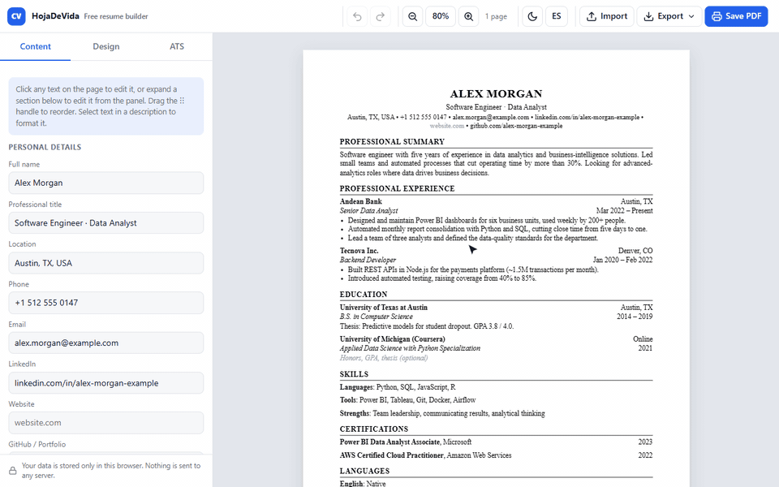
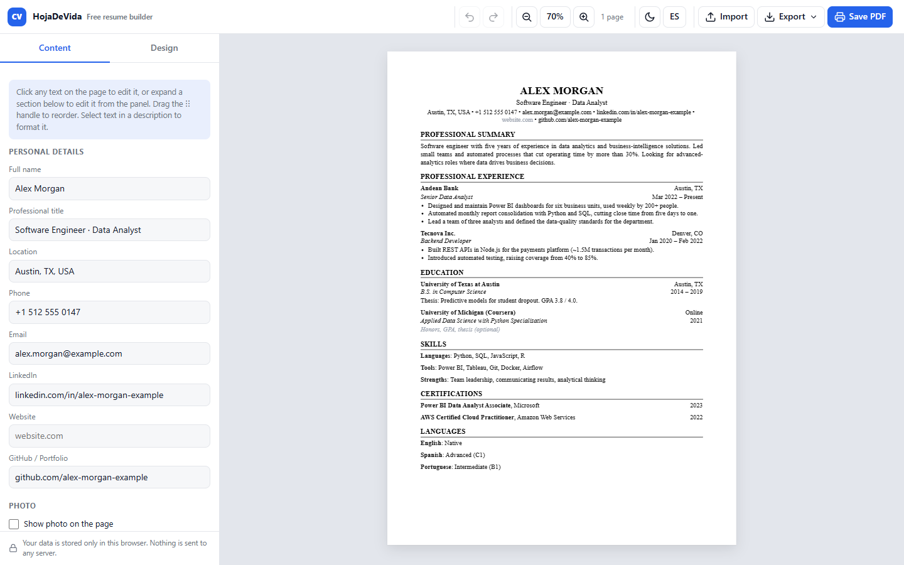
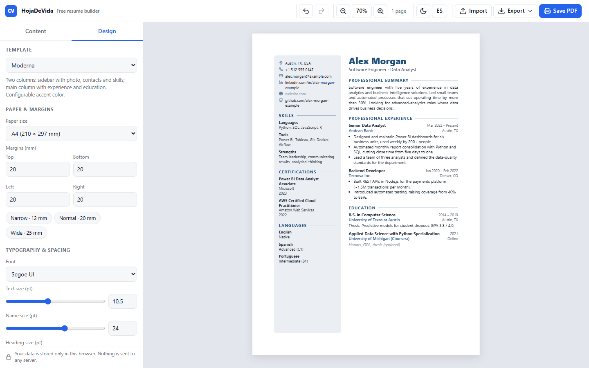
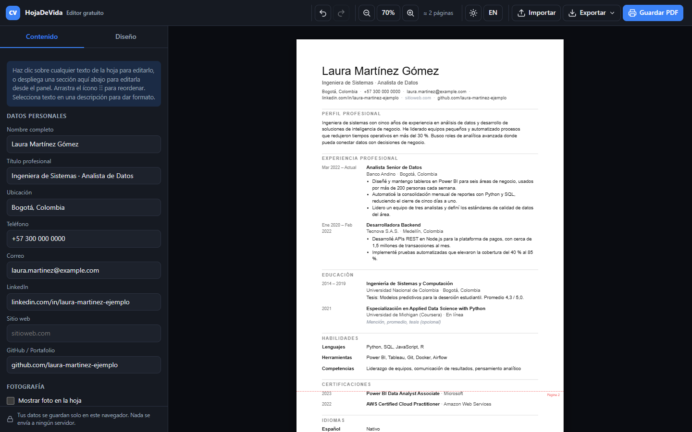
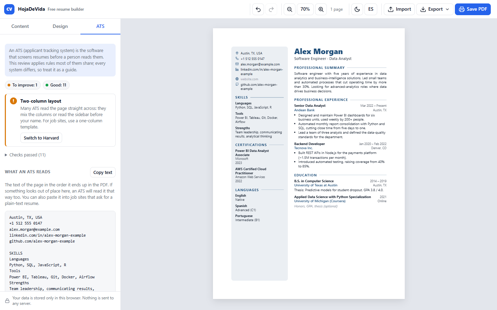

# HojaDeVida: free resume builder

**English** · [Español](README.es.md)

[](https://github.com/JulianContreras02/cv-builder/actions/workflows/ci.yml)


[](LICENSE)

**Live demo: <https://juliancontreras02.github.io/cv-builder/>**

[](https://juliancontreras02.github.io/cv-builder/)

A resume (CV) editor that runs entirely in the browser. You type directly on the page, pick a
template, and save a PDF. There is no account, no server, no paywall and no credit card: the data
stays in your own browser, and the PDF comes from the browser's print dialog, so the text is real,
selectable vector text with no watermark.

I built it because every resume site I tried asked for a credit card before letting me download my
own document.



| Modern template, design panel | Minimal template, dark mode, Spanish UI |
| --- | --- |
|  |  |

## Features

- **Edit on the page.** Every piece of text is editable with one click: name, contacts, section
  titles, job titles, dates, descriptions. Enter moves to the next field.
- **Or edit from the side panel.** Each section expands into a form with all its fields; both
  views stay in sync.
- **Date picker** for every date field: year, month or day precision, ranges or single dates,
  "Present", and several output formats (Mar 2022, March 2022, 03/2022…). The result is still
  plain editable text.
- **Rich text in descriptions.** Selecting text shows a floating toolbar (bold, italic, underline,
  lists, links). Typing `- ` at the start of a line starts a bulleted list.
- **Drag and drop** for sections and entries, on the page or in the panel, including touch screens
  (SortableJS). New sections can be dragged from the palette to the exact spot.
- **14 section types**: summary, experience, education, skills, languages, projects,
  certifications, awards, volunteering, publications, references, interests, custom and free
  text. Sections can repeat, be renamed, hidden without deleting, and entries can be duplicated.
- **Three templates**: Harvard (classic, one column), Modern (two columns with an accent color)
  and Minimal (dates in a left gutter, thin rules). Each template declares its own options and the
  panel draws them automatically.
- **ATS review**: a side-panel tab checks what applicant tracking systems look for, explains
  each finding, offers one-click fixes, and shows the text in the order a parser reads it
  (see [ATS review](#ats-review)).
- **Design controls**: font (system fonts or Google Fonts), text, name and heading sizes in
  points, line height, spacing, colors, paper size (A4, Letter, Legal, Oficio) and margins in mm.
- **Optional photo** with shape, size and position; it is resized and stored with the data.
- **PDF export** through the print dialog. Paper size and margins are applied automatically and
  entries are never split across pages.
- **Import and export** as JSON (everything, photo included) or CSV (long format that opens in
  Excel or Google Sheets). Both can be imported back. Ctrl+S downloads the JSON.
- **Undo and redo** (Ctrl+Z, Ctrl+Y), light and dark themes, Spanish and English UI, approximate
  page-break guides, zoom.
- **Private by design**: nothing leaves the browser. No accounts, no cookies, no analytics.

## ATS review

Most job applications go through an applicant tracking system (ATS) before a person reads them.
The **ATS** tab in the side panel reviews the resume against rules most of those systems share,
explains each finding, and offers a one-click fix when there is one.



| Check | Level | Why it matters | Fix |
| --- | --- | --- | --- |
| Name, e-mail (and its format) | To fix | The ATS builds the candidate record from them | Go to the field |
| Phone | To improve | Many processes start with a call | Go to the field |
| City | Suggestion | Recruiters filter by location | Go to the field |
| Experience, or projects/volunteering | To improve | Job titles, companies and dates are what it extracts | Add the section |
| Dates on experience and education | To improve | Years of experience are computed from them | Go to the first one missing |
| Skills | To improve | Keyword matching against the job posting | Add the section |
| Professional summary | Suggestion | Context for the ATS and the recruiter | Add the section |
| Standard section titles | Suggestion | Sections are recognized by their title ("Mi camino" is not) | Rename to the standard title |
| One column | To improve | Two columns get mixed up or read sidebar-first | Switch to Harvard |
| Name read first | To improve | Another line could be taken for the name | (shown in the text preview) |
| Letter-spaced headings | To improve | Some parsers read "S K I L L S" | Turn the template option off |
| One or two pages | To improve | What most recruiters expect | (shorten the oldest entries) |
| Photo | Suggestion | Ignored by an ATS; regional advice differs | (none) |

Below the findings, **What an ATS reads** shows the page's text in the order it ends up in the
PDF, which is the order a parser reads it. It walks the rendered page with the computed styles,
so it applies `text-transform`, keeps separators drawn by CSS (`•`, `|`), skips the editor-only
parts and hidden fields, and leaves a blank line between sections. The **Copy text** button puts
it on the clipboard for job sites that ask for a plain-text resume.

The checks live in [`js/ats.js`](js/ats.js): content checks read the data, layout checks read the
rendered page (number of `data-sections` containers, the first line of the text, the computed
`letter-spacing` of the headings), so new templates are checked without extra code. A template
can offer a `spacedHeadings` option, as Minimal does, and the fix will use it.

It is a guide, not an emulation: every ATS parses differently, and the review never changes the
design on its own. The Modern template is still a good choice when the resume goes straight to a
person.

## How it works

It is a static site with no build step and no npm: `index.html`, two stylesheets and a handful of
plain JavaScript files loaded with `<script>` tags. They share one global namespace, `window.CV`.

```
cv-builder/
├── index.html              UI skeleton, link-preview (Open Graph) tags
├── assets/                 favicon.svg and og-image.png (link preview)
├── css/
│   ├── app.css             Editor chrome (top bar, panel, light/dark theme)
│   └── sheet.css           Base page, editable fields, overlay controls, @media print rules
├── js/
│   ├── i18n.js             UI strings (es, en)
│   ├── schema.js           Section types, placeholders and sample data
│   ├── core.js             State, utilities, undo history, localStorage, mutations
│   ├── export.js           JSON and CSV export/import
│   ├── render.js           Draws the page, inline editing, drag and drop, zoom, page guides
│   ├── dates.js            Date picker (year/month/day, range, "Present", format)
│   ├── ats.js              ATS review: checks, text in reading order, the ATS tab
│   ├── app.js              Side panel, top bar, shortcuts, startup
│   └── templates/
│       ├── harvard.js      Harvard template
│       ├── modern.js       Modern template
│       └── minimal.js      Minimal template
├── tests/
│   ├── index.html          Browser test page (open it in any browser)
│   ├── harness.js          Tiny test harness, no dependencies
│   ├── specs/              Unit tests per module
│   └── browser.test.mjs    Runs the page and smoke tests in headless Chrome
├── tools/
│   ├── devtools.mjs        Static server, Chrome launcher and DevTools client (no npm)
│   └── record-demo.mjs     Records docs/demo-en.gif and docs/demo-es.gif
└── .github/workflows/
    └── ci.yml              Runs the tests, then deploys index.html, assets/, css/ and js/
```

The flow is one-directional:

1. **State** (`core.js`) is a single plain object: `profile`, `settings` and an ordered list of
   `sections`. Every mutation goes through a function that first pushes a snapshot onto the undo
   history, then saves to `localStorage` (debounced) and emits a `state` event.
2. **Rendering** (`render.js`) asks the active template for an HTML string and puts it on the page.
   Templates never touch the DOM or the state directly; they build markup with helpers such as
   `h.ed()` (editable text bound to a path like `sections.2.items.0.title`) and `h.section()`.
3. **Editing** on the page writes back through the same path, so the panel and the page always
   show the same data.
4. **Untrusted input is sanitized.** Pasted content is inserted as plain text. Rich text from the
   page and from imported files goes through an allowlist sanitizer (basic formatting tags only;
   links limited to `http`, `mailto` and `tel`), and plain fields are escaped when rendered.
5. **PDF**: the app writes an `@page` rule with the chosen paper size and margins, and print CSS
   hides the editor. The browser's own "Save as PDF" produces the file.

The only external dependency is SortableJS, loaded from cdnjs. If it fails to load, reordering
still works with the arrow buttons in the panel.

## Run it locally

Open `index.html` in a browser, or serve the folder to mirror production:

```bash
python -m http.server 8080
```

and go to <http://localhost:8080>.

## Tests

The tests keep the no-build, no-npm approach:

- **Unit tests** run in the browser. Open `tests/index.html` (double-click is enough) and the page
  lists the results. They cover the HTML sanitizer, state normalization, undo/redo, JSON and CSV
  round-trips, the date parser and formatter, translations, sample data, the ATS checks and
  their fixes, the reading-order text extraction, and the template
  contract (every template renders every visible section, every editable field points at real
  data, and profile text is escaped).
- **Smoke tests** drive the real app in headless Chrome: each template in each language must
  render without console errors, hide the editor and empty fields in print, and print to A4;
  the paper size picked in the design panel must reach the PDF; importing a JSON file through the
  Import button must replace the resume; a blank resume must print without placeholder text;
  and the ATS tab must pass Harvard, flag Modern's two columns and Minimal's letter spacing, apply
  their fixes, and follow edits made on the page.

Run both from the repository root with Node 22 or newer and Chrome installed (set `CHROME_PATH` if
Chrome is somewhere unusual):

```bash
node --test
```

[`tests/browser.test.mjs`](tests/browser.test.mjs) starts a static server, launches Chrome, opens
the test page and the app, and talks to Chrome through the DevTools protocol with Node's built-in
`WebSocket` (the helpers live in [`tools/devtools.mjs`](tools/devtools.mjs)). Printing uses the same
engine as Chrome's "Save as PDF"; the page count and paper size are read straight from the PDF.

### Demo GIF

The GIF at the top is recorded from the real app with the fictitious sample resume, so it can be
regenerated after a UI change. It needs Chrome and [FFmpeg](https://ffmpeg.org/) (or `FFMPEG_PATH`):

```bash
node tools/record-demo.mjs
```

```bash
node tools/record-demo.mjs --lang es
```

[`tools/record-demo.mjs`](tools/record-demo.mjs) drives the editor through the DevTools protocol,
collects screencast frames with their real timing and lets FFmpeg build the GIF with its own palette.
It draws a cursor and captions on top, because headless Chrome renders no mouse pointer, and switches
SortableJS to its fallback mode (the one used on touch screens) so the dragged block is visible.
It fails instead of writing a GIF if the drag does not reorder or the page logs an error.

## Deployment

Any static host works, because deploying means copying four things: `index.html`, `assets/`,
`css/` and `js/`.

This repository deploys to **GitHub Pages** with the workflow in
[`.github/workflows/ci.yml`](.github/workflows/ci.yml): every push and pull request runs the tests,
and when they pass on `main` the deploy job copies those files into a Pages artifact and publishes
it. A failing test never reaches the demo. README, docs, screenshots and tests are not part of the
public site. The repository's Pages source is set to **GitHub Actions** (Settings → Pages).

### Adding a custom domain later

The demo lives at `juliancontreras02.github.io/cv-builder/` as a *project site*. To serve it from
your own domain (for example `example.com`):

1. **Verify the domain** on your GitHub account first (profile Settings → Pages → Add a domain,
   then create the TXT record it shows). This stops anyone else from claiming it on GitHub.
2. **Create the DNS records** at your registrar:
   - apex (`example.com`): four `A` records to `185.199.108.153`, `185.199.109.153`,
     `185.199.110.153` and `185.199.111.153` (optionally the `AAAA` records
     `2606:50c0:8000::153` through `2606:50c0:8003::153`);
   - `www`: a `CNAME` record to `juliancontreras02.github.io` (no `/cv-builder` path).
3. **Set the domain on this repository**: Settings → Pages → Custom domain, or
   `gh api --method PUT repos/JulianContreras02/cv-builder/pages -f cname=example.com`.
   With an Actions workflow no `CNAME` file is needed; GitHub ignores it.
4. When the DNS check passes, tick **Enforce HTTPS**. The certificate is issued automatically.

Things to know before switching:

- The app moves from `/cv-builder/` to the root of the domain. All paths in the app are relative,
  so the code keeps working. The only exception is the link-preview tags in `index.html`:
  `og:url` and `og:image` must be absolute, so change them to the new domain.
- **Saved resumes do not follow the move.** `localStorage` belongs to an origin, so data saved on
  `juliancontreras02.github.io` is not visible on the new domain. Announce the change and ask
  users to use *Export → JSON* before and *Import* after.
- If you later put a custom domain on the user site `JulianContreras02.github.io`, project sites
  without their own domain are served under it (`your-domain/cv-builder/`). Giving this repository
  its own domain avoids that.

Cloudflare Pages, Netlify or Vercel also work with the same folder if you ever want to move.

## Tips for the PDF

- In Chrome or Edge choose **Save as PDF**, keep margins on "Default" (the app sets them) and turn
  off **Headers and footers** so the date and URL are not printed.
- The suggested file name is `Resume - <Name>.pdf` (`Hoja de Vida - <Nombre>.pdf` in Spanish).
- The dashed red lines in the preview are an **estimate** of the page break. The browser decides
  the exact break, but an entry is never split in half.
- "(Google)" fonts are downloaded from Google Fonts when selected and need internet. The others
  are system fonts and look the same on screen and in the PDF.

## Adding a template

1. Copy `js/templates/harvard.js` to `js/templates/<id>.js`.
2. Change `id`, `name`, `description`, `defaults`, `options`, `css` and `render`.
3. Add `<script src="js/templates/<id>.js"></script>` to `index.html` after the other templates.

It shows up in the "Template" selector on its own. The minimum contract the core needs:

```js
CV.registerTemplate({
  id: 'modern',
  name: { es: 'Moderna', en: 'Modern' },                          // or a plain string
  description: { es: '…', en: '…' },
  defaults: { fontFamily: 'Arial, sans-serif', fontSize: 10.5 },   // optional
  options: [                                                       // optional
    { key: 'accentBar', type: 'toggle', default: true, label: { es: 'Barra de color', en: 'Color bar' } },
    { key: 'cols', type: 'select', default: '1', label: { es: 'Columnas', en: 'Columns' },
      choices: [{ value: '1', label: '1' }, { value: '2', label: '2' }] },
  ],
  css: '.tpl-modern .cv-heading { … }',
  render(state, h, opt) {
    // 1) A section container marked with data-sections (needed for drag and drop).
    // 2) Each section through h.section(sec, i, html), its title through h.heading(sec, i).
    // 3) Entries through h.items(sec, i, (item, basePath) => html) and text through
    //    h.ed(path, value, {cls, ph}) or h.rich(path, value, {cls, ph}).
    // 4) The photo through h.photo().
    const secs = state.sections.map((sec, i) => sec.visible === false ? '' :
      h.section(sec, i, h.heading(sec, i) + this.renderBody(sec, i, h))).join('');
    return '<div class="tpl-modern" data-sections>' + header + secs + '</div>';
  },
});
```

The `h.*` helpers are defined and commented in `js/render.js`. The CSS variables available on the
page are `--font`, `--fs`, `--fs-name`, `--fs-heading`, `--lh`, `--gap-section`, `--gap-item`,
`--text`, `--accent`, `--photo-size` and the margins `--m-*`.

A two-column template has two `data-sections` containers (see `modern.js`). Each one is its own
drag group, so sections reorder within their column and the template decides the column by
section type. The relative order in the model is preserved, so switching templates never mixes
sections up.

## Adding a section type

In `js/schema.js`, add an entry to `CV.SECTION_TYPES` with a `layout` (`block`, `entry`, `line` or
`compact`), `fields`, `label` and `ph`, and add its key to `CV.SECTION_ORDER`. The existing
templates already know how to draw the four layouts.

## Data formats

**JSON** is the full state (`profile`, `settings`, `sections`) and the recommended backup format.
Entries whose dates came from the picker also store `datesData` (`precision`, `format`, `range`,
`current`, `start`, `end` in ISO format) so the picker reopens with the same values; the visible
text is always in `dates`.

**CSV** uses a long format, one row per value (the photo is not included):

```
scope,section_id,section_type,section_title,item_index,field,value
profile,,,,,name,Alex Morgan
settings,,,,,fontSize,11
section,abc123,experience,Professional Experience,,visible,true
section,abc123,experience,Professional Experience,0,org,Andean Bank
section,abc123,experience,Professional Experience,0,description,"- First achievement
- Second achievement"
```

Descriptions are exported as text with `- ` per bullet and turned back into lists on import.

## License

[MIT](LICENSE) © 2026 Julian Contreras
